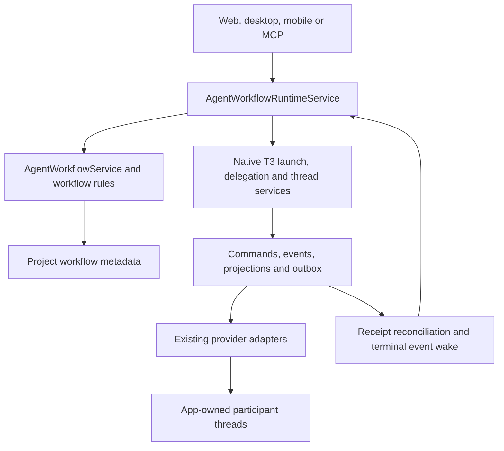

# Technical design: supervised agent workflows

Implementation candidate for [PR #2](https://github.com/vib3oh/coder-t3-omid/pull/2),
based on the accepted [spec](spec.md). The [investigation](understanding.md)
retains the separate, bounded Hypercoder evidence. The PR records verification;
this document does not certify model behavior or live provider compatibility.

## Ownership and native execution

T3 continues to own threads, provider sessions, task lineage, approvals,
worktree preparation, command receipts, messages and hidden Git checkpoints.
The fork adds role snapshots, assignment acceptance, structured artifacts and
correlated team communication. It does not run a separate conductor or provider
process manager.

The manager is an app-owned root thread. Bounded role assignments use native
asynchronous delegation in its checkout. The manager yields after dispatch;
native task completion wakes it. A finished task does not accept an assignment:
only a valid structured result can do that. Builder owns repairs, followed by a
fresh independent Reviewer against the new exact snapshot. Reviewer instructions
are advisory behavior, not a provider filesystem sandbox.

Implementation assignments may take a subset of the frozen criterion IDs and
text. This keeps later review requirements from becoming prerequisites for
Builder acceptance. The final Reviewer must take and satisfy every workflow
criterion; stage scoping never removes one from the workflow or its final gate.

The snapshot response and Reviewer brief use the same check-command compiler.
Reviewer receives each exact execution string for the accepted implementation;
it does not need to reconstruct the verification protocol or create a snapshot.

Client mutations use `createEnvironmentRpcCommand` and destination permission
atoms. The server checks read/operate scopes. MCP additionally requires an
orchestration-capable credential and an authenticated participant; the caller
cannot supply another sender identity. Native app-owned dispatch entry points
prevent workflow participants from evading the supervised service through
untracked delegation or peer sends. Provider-native subagents and arbitrary shell
programs remain outside this application-level enforcement boundary.

## Contracts and storage choice

The executable contracts are [workflow contracts](../../../packages/contracts/src/forkAgentWorkflows.ts)
and [bounded views](../../../packages/contracts/src/forkAgentWorkflowViews.ts).
They define project role revisions, immutable skill/instruction snapshots,
workflow generations, assignment attempts, evidence and communication facts.
Use those types instead of maintaining a second API field catalog here.

Native persistence has typed commands/events/projections for native task facts;
it does not expose a stable arbitrary extension-metadata store. Putting role,
question and acceptance state into those unions would spread this fork through
the orchestrator. Putting it into roadmap cards would couple thread-only use to
an unrelated planning board and increase board-save contention. The implementation
therefore follows the fork's existing atomic project-JSON approach in
`<stateDir>/extensions/agents`, bounded to 32 MiB per project. The application-owned
service and keyed locks serialize updates. Corrupt state fails without silently
replacing it with an empty store.

The JSON commit and native command commit are separate transactions. An action
intent is persisted first; dispatch uses stable native command/message ids; its
native receipt/task is then attached. Recovery reads native events and receipts
before deciding whether an attempt needs a new request. It does not promise
exactly-once provider execution or recreate an expired parent run. A pending root
launch replays the full native launch, including its immutable initial message,
rather than treating an empty thread shell as successful initialization.

A runtime lock covers each workflow's native side-effect phase and recovery, in
addition to the project metadata lock. Intent records name the captured attempt,
so a delayed cancellation or acknowledgement cannot affect a newer retry.
Cancellation invalidates generations, disposes completion wakes and cancels owned
queued/running work while retaining conversations and worktrees. Pause admits no
new assignments; it does not imply that already-running turns stopped.

## Roles and built-in procedures

[The built-in package](../../../apps/server/src/fork/skills/BuiltinSkillService.ts)
materializes independently authored definitions into immutable, content-addressed
server state. It generates Codex extra skill roots and a Claude local plugin from
one catalog. Existing native discovery, precedence, invocation restrictions and
composer selection remain authoritative. No personal configuration is overwritten
and no personal Vibe installation is required.

Codex uses native `skills/extraRoots/set` before discovery/turn initialization.
An unsupported CLI keeps ordinary provider behavior and reports the required
bundled source as unavailable. Claude uses its existing native initialization
probe: only accepted namespaced plugin commands enable the app-owned discovery
root and plugin query option. Failed plugin initialization retries ordinary
initialization without that option.

The compiler resolves canonical ids and aliases, transitive dependencies, native
paths, enabled/invocation flags and capability prerequisites. Required failures
block readiness. Optional unavailable procedures remain visible with a reason.
User-only procedures cannot enter autonomous role bundles. The saved assignment
contains the exact model selection, resolved skill versions/hashes, instruction
hash and compiled brief. Catalog edits affect future assignments; retries never
silently replace a frozen brief with newly compiled instructions.

Planner, Builder, Reviewer, Designer and Debugger have small default bundles and
fixed output kinds. Project presets can be cloned and edited with revision
conflicts preserved. Codex and Claude have native package adapters; other provider
formats explicitly remain unsupported for this bundled-role path. Operational
procedures retain their profile/capability requirements. Kits/pane templates and
games remain excluded. See the [combined audit](skill-audit.md) for provenance
and [migration matrix](skills.md) for the audited source scope.

## Workspace and evidence

Starts resolve a clean source checkout and explicit commit through native Git
and launch services. A card launch freezes its board revision, criterion ids/text
and resolved bounded spec content/hash, then reserves the manager link using the
board's expected revision. Existing linked card ownership is preserved; ordinary
roadmap build and managed repair-review actions retain their semantics. Workflow
completion does not change derived board lanes, explicit card completion or PR
approval.

The first template serializes writers and reviewers in one checkout. Native run
state is checked before responsibility transfers; an accepted artifact submitted
mid-turn cannot release an active writer. Limits cover supervised assignments,
continuation attempts, review rounds and message volume. Only the user can raise
limits. Opaque subscription/provider token coverage is not an exact dollar cap.

Builder/Debugger freeze work through T3's hidden checkpoint store, without
committing to the user's branch. New owned files must be staged so Git can bind
them. [Evidence verification](../../../apps/server/src/fork/agents/WorkflowEvidence.ts)
resolves the snapshot and checks current workspace applicability. Required check
commands are frozen at launch. Their proof must name canonical native
`command_execution` records from the actual participant/run, with successful
completion, exact declared wrapper and matching revision markers. A prose claim,
a changed `required` flag or a provider terminal event cannot replace that proof.

Reviewer artifacts pin the accepted implementation snapshot. New revisions
invalidate prior applicability. Findings go to Builder; another review is a fresh
assignment. Verification establishes provenance and command execution, not the
semantic adequacy of an arbitrary test command. Independent review and human
judgment remain necessary.

## Messages, waits and readable presentation

Team messages have server-stamped origin/sender, exact recipient, workflow
identity, generation, kind, summary and optional explicit reply relationship.
An acknowledgement means receipt; an answer names its question; neither means
work completed. Unrelated updates cannot resolve concurrent questions. Circular
blocking waits are rejected, and bounded timeouts expose escalation.

Messages and their intents are committed together. If the recipient is active,
the intent waits for a native turn boundary. Resuming a finished child waits for
its exact native task to finalize, then records the new task and canonical parent
run. Native sibling follow-ups retain authenticated sibling provenance and use
the existing manager completion wake. Capacity defers dispatch; attempt limits
fail explicitly before spending a new turn. Recovery wakes from native terminal
run/task events and question deadlines, without an agent polling loop.

Workflow detail groups semantic routine updates with stable identities and a
one-line summary/update count. Questions, failures, final results and differing
revisions stay distinct. Expanding loads readable bodies; a separate disclosure
shows original payload and transport identifiers. Sender summaries remain
separate from verified delivery facts. Search includes hidden body text.

Ordinary thread timelines retain upstream peer-message folding, with a friendly
sender/recipient summary on the first line. Successful outgoing tool receipts
are compact and may be correlated by exact native message id; failures and
unfinished tool work remain visible. Semantic grouping and dedicated diagnostics
live in workflow detail, rather than inferring trusted metadata from protocol
prose in legacy thread rows.

Metadata views omit compiled prompts, source bodies and detailed artifact proof.
Bodies load on demand; message/artifact history pages from newest to oldest.
Native approvals/user-input requests use native shell summaries and link to the
existing conversation controls. They are distinct from peer questions. Web and
desktop share launch/role/detail operations; native mobile supports monitoring,
evidence, replies, revision requests, limits and lifecycle management.

## Upstream updates and verification

[fork.json](../../../fork.json) records actual owned modules, shared hooks and
verification paths. Retain the native services when community T3 changes their
boundaries; remove fork duplicates when an equivalent upstream capability is
adopted. A conflict-free rebase alone does not establish compatibility.

Focused tests cover idempotency, permissions, aliases, role outputs, revision
checks, evidence, waits, native continuation lineage, cancellation and partial
launch recovery. Model-facing evals import actual compiler/instruction/tool
source and distinguish dry-runs from real model results. Integrated client and
native-provider checks, changed-file validation, current-source UI evidence and
published CI remain separate release gates recorded on PR #2.
